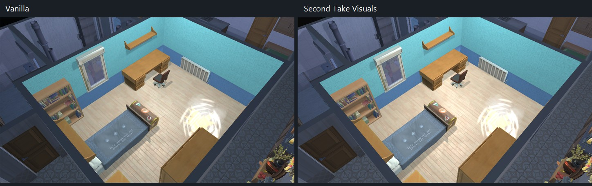

# Youtubers Life: Second Take

Second Take is a collection of mods for the original Windows version of *Youtubers Life*. Its first module, **Visuals**, gives the starting bedroom softer light on the desk and furniture, improves the filtering of existing room textures, and adds a wide camera preset.



## Install Visuals

[Download Second Take Visuals 0.1.0](downloads/SecondTake-Visuals-0.1.0.zip?raw=true)

1. Install BepInEx 5 x64 in the game directory. An existing installation for Creator Probe works.
2. With the game closed, copy `SecondTake.Visuals.dll` into `BepInEx\plugins`. The packaged ZIP includes that folder structure.
3. Launch through Steam and enter the starting bedroom. Press **F6** to compare the preset with vanilla. Press **F7** for a wider view. You can still pan, rotate, and zoom normally.

The default view keeps your camera position. The fill follows the bedroom camera, and the texture settings restore when you switch the preset off or leave the room. Visuals runs independently of Creator Probe.

To adjust the light, texture bias, or hotkeys, close the game and edit `BepInEx\config\mikematt33.secondtake.visuals.cfg` after the first launch. To uninstall, close the game and remove `SecondTake.Visuals.dll`.

## Build on Windows

From the repository root in PowerShell, pass the directory containing your game executable and BepInEx installation.

```powershell
.\mods\Visuals\Build.ps1 -GameRoot 'Z:\SteamLibrary\steamapps\common\YoutubersLife'
```

The compiler writes `mods\Visuals\bin\SecondTake.Visuals.dll`. The build references the installed game and loader directly.

## Tested scope

Version 0.1.0 was rendered in the original Steam build 20266504, using Unity 2021.3.0f1, Direct3D 11, and BepInEx 5.4.23.6. The comparison shows the shipped starting-bedroom scene loaded directly in a test copy. A career normally adds the player, desk equipment, and interface. The scene test checked texture restoration, fill-light cleanup, camera distance restoration, and disabling the preset outside the bedroom. A full career session with manual hotkeys remains to be playtested.
